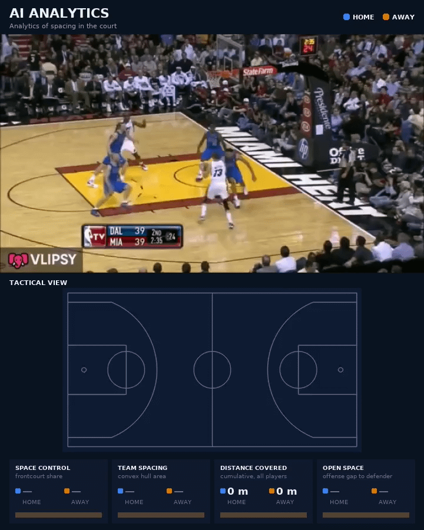
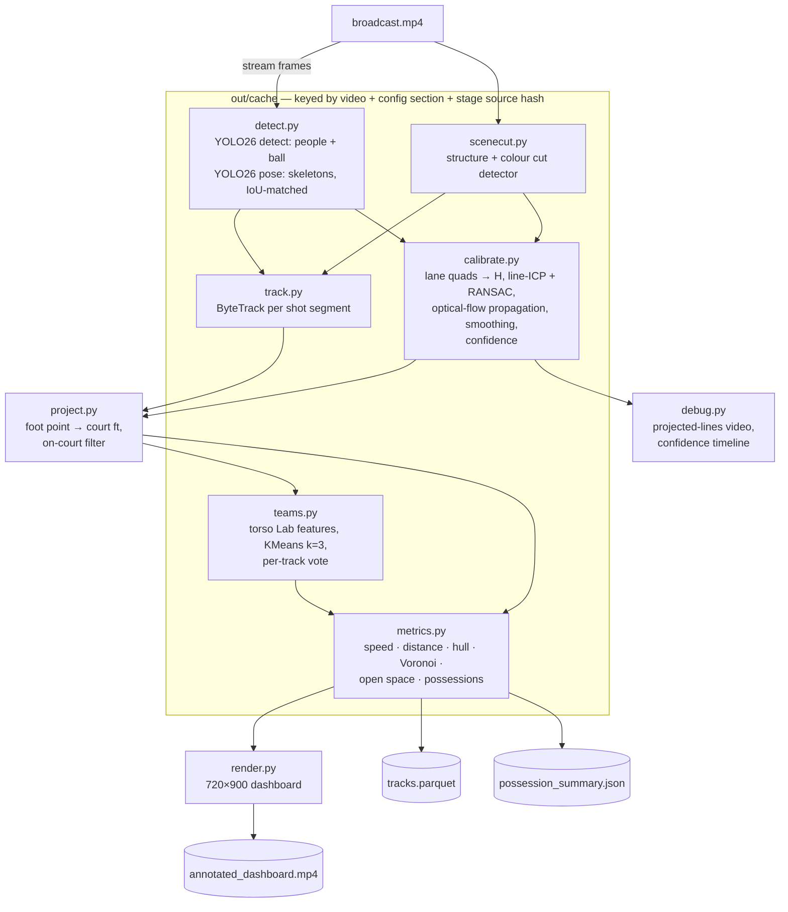

# Basketball Court Mapper

<p align="center">
  
</p>

Turns a single broadcast basketball clip into tactical analytics and a dashboard video:
the annotated broadcast on top, a live 2D tactical court in the middle, and four
team-vs-team stat tiles at the bottom.

| Output | What it is |
|---|---|
| `out/annotated_dashboard.mp4` | 720×900 portrait dashboard (H.264) |
| `out/tracks.parquet` | per-frame, per-player court position (ft and m), speed, cumulative distance, team |
| `out/possession_summary.json` | per-possession duration, spacing, space control, distance, open space |
| `out/debug/court_projection_debug.mp4` | court lines projected onto the broadcast for checking the homography |
| `out/debug/calibration_confidence.png` / `.csv` | calibration-confidence timeline (cuts marked) |
| `out/stage_timings.json` | wall time and ms/frame per stage |

## Setup

Python 3.11 (3.10+ works). On Windows:

```powershell
py -3.11 -m venv .venv
.venv\Scripts\python -m pip install -r requirements.txt
```

The model weights (`models/yolo26s.pt`, `models/yolo26n-pose.pt`) download automatically
the first time they're used if they aren't already in `models/`. A GPU is optional.
On CPU, a 28 s 360p clip takes about 7 minutes end to end, mostly detection.

## Usage

```powershell
.venv\Scripts\python -m hoopsvision run --video samples\clip.mp4 --out out
```

```powershell
.venv\Scripts\python -m hoopsvision render --video samples\clip.mp4 --out out
```

`run` executes every stage, reusing cached stages. `render` rebuilds the dashboard
from the cache only and never loads a model. Other flags:

- `--config path.yaml`: thresholds, model paths, court dimensions, team labels and colors (see `config.yaml`)
- `--max-frames N`: process only the first N frames (quick iteration)
- `--force calibrate teams`: recompute specific stages (`all` recomputes everything)
- `-v`: debug logging

Tests: `.venv\Scripts\python -m pytest -q` (25 tests, about 3 s, no models or video needed).

## Architecture



### Stages

1. **detect.py** finds people and the ball with a YOLO26 detection model. Pose models
   find far fewer people on soft 360p footage (3–9 vs 15–17 per frame here), so a
   pose model only adds keypoints to person boxes matched by IoU (Hungarian
   assignment). Tiny far-away detections are dropped here. Separating on-court
   players from crowd and bench happens after calibration (`project.py`), when foot
   points can be tested against the court polygon.
2. **scenecut.py** finds camera cuts with two signals. One is zero-normalized
   correlation of gradient images on histogram-equalized gray, which ignores
   exposure changes. The other is HSV histogram distance. A colour jump with intact
   structure is an exposure flash, not a cut. Segments between cuts are the unit
   for tracking and calibration resets.
3. **track.py** runs ByteTrack (Roboflow `trackers`, the successor to
   `supervision.ByteTrack`) with a fresh tracker per segment and offset IDs, so an
   ID never spans a cut. `lost_track_buffer` keeps occluded players alive.
4. **calibrate.py** estimates a court→image homography every frame (details below).
5. **project.py** turns each player's ground point into court coordinates. It uses
   the ankle keypoints when both are confident, otherwise the box bottom-centre. A
   track counts as on-court if most of its calibrated frames fall inside the court
   (plus a 3 ft margin).
6. **teams.py** builds a torso-crop feature `[L − L_floor, a, b, std L]` with
   floor-coloured pixels masked out, clusters with KMeans (k=3), and assigns each
   track the majority vote of its samples. The referee cluster is the one with the
   fewest people per frame (about 3 vs 5). A track is labelled referee only when
   that cluster holds ≥60% of its votes; otherwise it takes the majority of the two
   team clusters. The lighter jersey is HOME (`teams.home_jersey`). Display labels
   come from config.
7. **metrics.py** works entirely in court feet, with metric twins:
   - **speed**: per-track Savitzky–Golay smoothing over 0.5 s, single-frame glitch
     rejection, steps above `max_speed_kmh` discarded rather than clipped.
   - **distance**: cumulative per player and per team.
   - **team spacing**: convex hull area.
   - **space control**: Voronoi cells (exactly tiling the court by mirroring
     points), full court and frontcourt-only.
   - **open space**: each attacker's distance to the nearest defender, plus a ball
     handler when a ball is detected.
   - **possessions**: from the attacking-team and side label (the team farther from
     the attacked hoop is on offense), majority-smoothed, with short flickers
     absorbed.
8. **render.py** composes the dashboard. Overlays use supervision annotators
   (EllipseAnnotator, EdgeAnnotator), and text uses a bundled font (DejaVu Sans
   Bold) so output is identical everywhere. The blue/amber pair (`#3B82F6` /
   `#D97706`) was checked for colour-vision-deficiency separation and contrast on
   the dark background. Tiles show an EMA of valid frames, and the split bars turn
   grey when values go stale during low-confidence stretches.

### Calibration in detail

Generate-and-verify, per frame:

- **Observe.** Segment the floor (dominant floor colour, closed and hole-filled).
  Build a court-line mask from thin structures of *either* polarity: this arena
  paints dark lines on wood, others paint white. Find lane candidates by clustering
  non-floor saturated colours (a lane is often fill colour plus border band) and
  fitting quads with sequential RANSAC on mask boundaries, ignoring edges created
  by occluding players or broadcast graphics.
- **Propose.** Each lane quad gives a homography from four corners. The basket side
  comes from the lean of the lane's end lines (a sideline-camera vanishing-point
  property). The previous estimate carried forward by camera motion is also a
  candidate. Camera motion is sparse LK optical flow plus a RANSAC homography on
  equalized gray (ECC is available in config), with players and graphics masked.
- **Refine.** ICP against the line mask: project about 600 template points at 1 ft
  spacing, match each to the nearest line pixel through a distance transform, refit
  with RANSAC, and shrink the radius each iteration.
- **Verify.** Combine line agreement (template points within 3 px of a line) with
  lane IoU (projected lane polygon vs the observed paint blobs it touches, using a
  paint colour learned from confident frames).
- **Smooth.** A motion-compensated EMA on four reference points: predict with
  camera motion, then blend toward the measurement. This avoids lag during pans.
  It resets on cuts.
- **Confidence.** A fit that can't be verified by the lane check fades to zero over
  `max_propagation_frames`. Analytics skip frames below `low_conf_threshold`, so
  those frames get NaN instead of bad numbers.

Static broadcast graphics (scorebug, watermark) are found automatically: textured
pixels whose gradients don't change while the camera pans. They're masked from
line fitting, motion estimation and jersey sampling.

## Results on the sample clip

28 s, 640×360, 30 fps, CPU only:

| | |
|---|---|
| detections | ~14.5 people/frame; ball found in 72 frames |
| scene cuts | 2 true cuts found (frames 194, 343); 5 exposure flashes correctly ignored |
| calibration | 86% of frames ≥ 0.45 confidence |
| analytics-valid frames | 81% |
| players with valid court positions | ~5–6 per valid frame (of ~10 on court) |
| speeds | median 8.5 km/h, p99 29 km/h |
| timing | detect 296 ms/frame · calibrate 180 · render 30 · everything else < 15 |

How to read this honestly:
- **Calibration** is good on the first and third camera segments: lane, arc and
  baselines line up within roughly 1–3 ft (check
  `out/debug/court_projection_debug.mp4`). It's weaker on the lower-angle second
  segment (frames 194–343), where the lane's near edge is hidden by the scorebug
  and some frames are confidently off by several feet.
- **Coverage.** About half the players have valid positions in a given frame,
  limited by tracker recall on small, blurry players and by on-court filtering.
  Absolute spacing and distance numbers are therefore lower bounds. Compare them
  between teams and over time, not against league benchmarks.

## Failure modes

| Situation | What the code does | Trade-off |
|---|---|---|
| **Camera pan** | Frame-to-frame camera motion (LK + RANSAC homography on background features, players and graphics masked) predicts the homography. The smoother is motion-compensated, so it doesn't lag behind the pan. | Motion errors accumulate. Without a lane check, confidence fades to 0 over 60 frames, so long pans away from the paint pause analytics instead of drifting. |
| **Camera zoom / tight shots** | Lane search plus line-ICP. When fewer than `min_visible_template_pts` court points are visible, it propagates the last good homography with decaying confidence. | Close-ups have little court geometry. Frames get flagged rather than guessed, so analytics have gaps in tight shots. |
| **Occlusion** | ByteTrack keeps lost tracks for 45 frames, kinematics bridge gaps ≤ 6 frames, and the team label is a per-track vote, so a few bad crops don't flip it. Lane fitting ignores edges next to player boxes. | Longer occlusions or crossing players can still swap or fragment IDs. A swap shows up as a speed spike, which is rejected rather than added to distance. Fragmented tracks lower per-frame coverage. |
| **Broadcast cuts** | The cut detector (structure + colour) resets the tracker, the calibration state and the smoother at each cut. IDs never span a cut. | IDs aren't re-identified across cuts (no appearance re-ID), so one player gets several IDs per clip. Per-player distance resets at a cut; team totals don't. |
| **Exposure flashes / colour grading** | The cut detector equalizes before comparing structure, motion estimation runs on equalized gray, the paint colour is re-learned by EMA, and jersey lightness is measured relative to the floor. | The learned paint colour lags a sudden grade change for a few frames. Confidence dips and recovers (visible in the timeline). |
| **Replays and graphics overlays** | Static graphics are auto-masked; `calibration.ignore_regions` adds manual boxes. A replay usually starts with a cut, which resets state. Replays from a non-sideline camera fail the lane/side check and get low confidence. | A replay from the *same* sideline camera looks like live play and would be analysed twice. There's no replay classifier (a logo-wipe detector would be the next step). |
| **Fast breaks** | Each frame decides the attacking side from player positions, and a possession changes when the attacking team or side changes. Basket-side hypotheses are re-evaluated whenever a lane is visible. | During transition the side heuristic can flicker. Possession smoothing (1 s) and a minimum length (2.5 s) absorb this, at the cost of up to about 1 s of latency on real changes. Same-team resets (offensive rebound, shot-clock reset) aren't split. |
| **Unpainted lanes / other arenas** | Lane candidates come from colour clustering, and line polarity is handled both ways. | An arena with an unpainted lane gives no lane quad. Calibration then relies on `manual_anchors` (one hand-labelled frame per segment) or would need a court-keypoint model (see trade-offs). |
| **Bench, crowd and courtside staff** | Size filter, then the court-polygon test on projected feet (track-level majority), then the referee/other cluster. | Players standing well outside the lines (inbounding) can be dropped; staff standing on the court edge can be kept. |

## Config

Everything tunable is in [config.yaml](config.yaml): model paths, device and input
size, court dimensions (NBA defaults; set FIBA values there), tracker buffers,
torso crop window, calibration thresholds, smoothing and decay, possession
smoothing, and render theme. No team names, logos or league branding are
hard-coded. `teams.labels` defaults to `[HOME, AWAY]`.

## Project layout

```
hoopsvision/
  __main__.py   CLI (run | render)
  pipeline.py   stage orchestration, caching, timing
  config.py     defaults + YAML deep-merge
  court.py      court geometry, homography helpers (pure)
  video.py      streaming reader, H.264 writer
  cache.py      stage cache (parquet / npz / json + manifest)
  timing.py     per-stage timers
  detect.py  scenecut.py  track.py  calibrate.py  project.py  teams.py  metrics.py
  render.py     dashboard
  debug.py      projected-lines video, confidence timeline
tests/          25 tests: court, cuts/tracking, calibration on synthetic renders,
                synthetic tracks (homography, Voronoi tiling, speed), possessions
```

See [TRADEOFFS.md](TRADEOFFS.md) for the engineering write-up.
